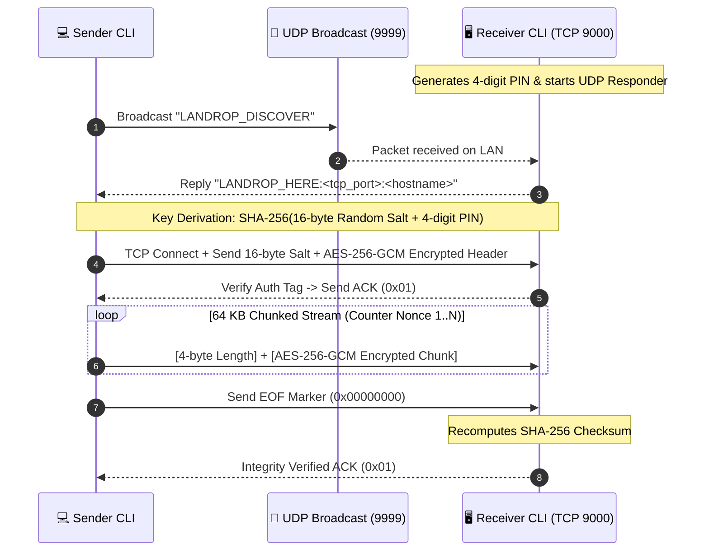

# 🚀 lan-drop

[](https://github.com/<username-anda>/lan-drop/actions)


**`lan-drop`** is a fast, zero-configuration, encrypted Peer-to-Peer (P2P) file transfer CLI for Local Area Networks (LAN), built in **Rust** with asynchronous I/O powered by **Tokio**.

No cloud servers, no file size limits, and no manual IP lookups required.

---

## ✨ Key Features

- 🔍 **Zero-Config UDP Auto-Discovery:** Automatically locates active receivers on the same Wi-Fi/LAN subnet via UDP broadcast (`port 9999`) without colliding with Linux `avahi-daemon` (`port 5353`).
- 🔐 **End-to-End Authenticated Encryption:** Every file header and data chunk is encrypted using **AES-256-GCM** derived from a 4-digit session PIN and a random 128-bit cryptographic salt.
- ⚡ **Constant-Memory Async Streaming:** Streams files in `64 KB` chunks over TCP (`tokio`), allowing multi-gigabyte transfers with `< 10 MB` RAM footprint.
- 🛡️ **End-to-End Integrity & Path Sanitization:** Verifies full-file **SHA-256** checksums on completion and strips directory traversal sequences (`../`) automatically.
- 📊 **Live Terminal Telemetry:** Real-time transfer speed (`MB/s`), progress bar, and ETA powered by `indicatif`.

---

## 🏗️ System Architecture & Protocol Flow



---

## 📦 Installation

### Build from Source (Cargo)
```bash
git clone https://github.com/<username-anda>/lan-drop.git
cd lan-drop
cargo build --release
sudo cp target/release/lan-drop /usr/local/bin/
```

---

## 🚀 Quick Start Usage

### 1. Start Receiver (Device A)
```bash
lan-drop receive
# Output:
# 📡 Menunggu kiriman fail di port TCP 9000 (UDP Auto-Discovery aktif)
# 🔐 Kod PIN Keselamatan: 4829
```

### 2. Send a File Automatically (Device B)
```bash
lan-drop send --file archive.tar.gz
# Output:
# 🔍 Mencari peranti penerima dalam rangkaian LAN...
# ✅ Ditemui 'ubuntu-peer' di 192.168.1.42:9000
# 🔑 Masukkan PIN 4-digit daripada skrin penerima: 4829
```

### 3. Direct IP Mode (Optional Bypass for Restricted Subnets)
```bash
lan-drop send --file archive.tar.gz --addr 192.168.1.42:9000 --pin 4829
```

---

## 🐧 Linux Firewall Configuration (`ufw`)

If you are transferring across two physical machines on Ubuntu/Debian with `ufw` enabled, allow the discovery and transfer ports:

```bash
sudo ufw allow 9999/udp
sudo ufw allow 9000/tcp
```

---

## 📄 License

Distributed under the MIT License.
