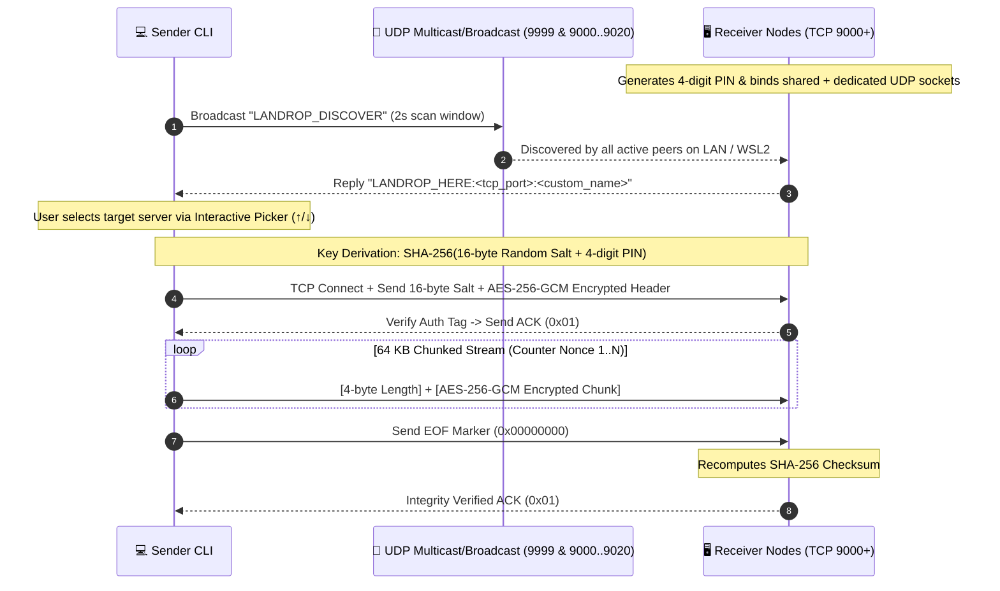

# 🚀 LAN-File-Dropper

[](https://github.com/Wishprogram01/LAN-File-Dropper/actions)


**`lan-drop`** is a fast, zero-configuration, encrypted Peer-to-Peer (P2P) file transfer CLI for Local Area Networks (LAN), built in **Rust** with asynchronous I/O powered by **Tokio**.

No cloud servers, no file size limits, and no manual IP lookups required.

---

## ✨ Key Features

- 🎯 **Interactive Multi-Peer Picker (AirDrop UX):** Automatically scans the LAN for 2 seconds and lets you choose from multiple active receivers using arrow keys (`↑`/`↓`) via `dialoguer`.
- 🏷️ **Custom Receiver Identities (`--name`):** Label each receiving node with a custom display name (e.g., `Zwdevs-Main-Rig`, `Ubuntu-Backup-Node`) for clear identification.
- 🔍 **Hybrid UDP Discovery (LAN + WSL2 Ready):** Combines **UDP Multicast (`239.255.42.99`)**, **LAN Broadcast (`port 9999`)**, and dedicated per-port UDP listeners (`9000..=9020`) so multiple peers are reliably discovered across physical Wi-Fi networks, Linux, and WSL2.
- 🎨 **Cyberpunk Terminal UI Banner:** Features a clean ANSI-colored ASCII art header (`LAN-DROPPER FILE BY ZWDEVS`) and live transfer telemetry (`█▓░` progress bar, `MB/s`, and ETA).
- 🔐 **End-to-End Authenticated Encryption:** Every file header and data chunk is encrypted using **AES-256-GCM** derived from a 4-digit session PIN and a random 128-bit cryptographic salt.
- ⚡ **Constant-Memory Async Streaming:** Streams files in `64 KB` chunks over TCP (`tokio`), allowing multi-gigabyte transfers with `< 10 MB` RAM footprint.
- 🛡️ **Integrity & Path Sanitization:** Verifies full-file **SHA-256** checksums on completion and strips directory traversal sequences (`../`) automatically.

---

## 🏗️ System Architecture & Protocol Flow



---

## 📦 Installation

### Option 1: Download Prebuilt Binary
Download the latest release binary for **Linux**, **macOS**, or **Windows** from the [GitHub Releases](https://github.com/Wishprogram01/LAN-File-Dropper/releases) page.

### Option 2: Build from Source (Cargo)
```bash
git clone https://github.com/Wishprogram01/LAN-File-Dropper.git
cd LAN-File-Dropper
cargo build --release
sudo cp target/release/lan-drop /usr/local/bin/
```

---

## 🚀 Quick Start Usage

### 1. Start One or More Receivers (Device A / B)
```bash
# Default port (9000) with custom display name
lan-drop receive --name "Zwdevs-Main-Rig"

# Run a second receiver on another port
lan-drop receive --port 9001 --name "Ubuntu-Backup-Node"
```

### 2. Scan & Pick a Receiver Interactively (Sender)
```bash
lan-drop send --file archive.tar.gz
# 1. Scans LAN for 2 seconds
# 2. Select target peer using ↑ / ↓ and Enter
# 3. Enter the 4-digit PIN shown on the receiver screen
```

### 3. Direct IP Mode (Optional Bypass for Restricted Subnets)
```bash
lan-drop send --file archive.tar.gz --addr 192.168.1.42:9000 --pin 4829
```

---

## 🐧 Linux Firewall Configuration (`ufw`)

If transferring across physical Ubuntu/Debian machines with `ufw` enabled, allow the discovery and transfer ports:

```bash
sudo ufw allow 9999/udp
sudo ufw allow 9000:9020/tcp
sudo ufw allow 9000:9020/udp
```

---

## 🗺️ Changelog

- **v0.2.0:** Added interactive Multi-Peer Picker (`dialoguer`), custom `--name` receiver labels, hybrid UDP Multicast + per-port discovery (WSL2 support), and ANSI ASCII art UI banner.
- **v0.1.0:** Initial release with raw TCP 64 KB async streaming, AES-256-GCM encryption, SHA-256 verification, and basic UDP broadcast discovery.

---

## 📄 License

Distributed under the [MIT License](LICENSE).
